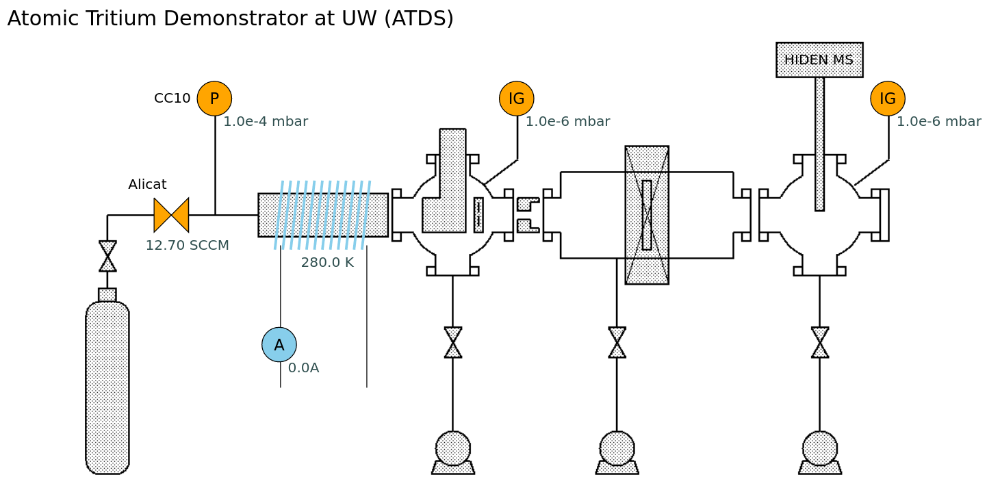
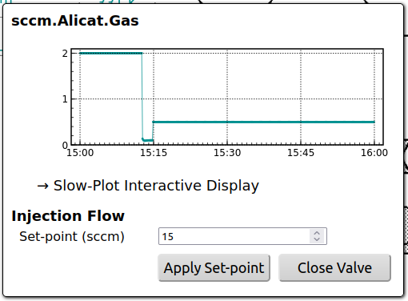
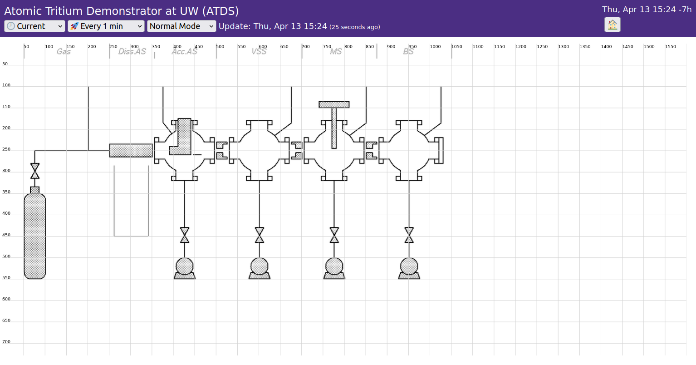
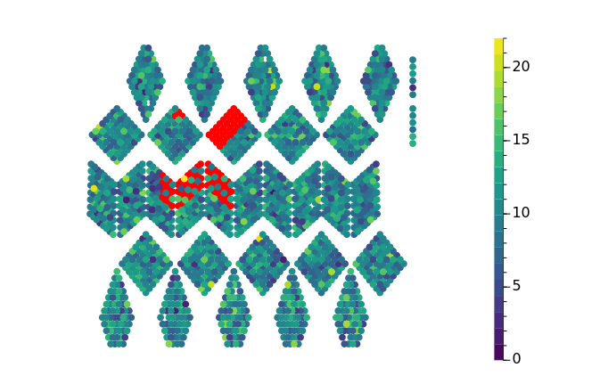
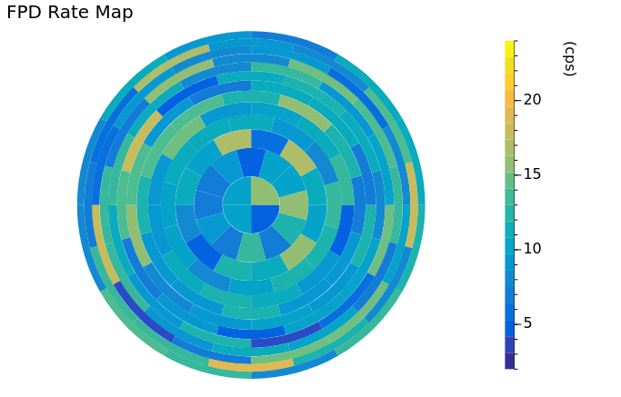

# Time-Axis Plot (Time-Series)
- Plots numeric time-series data against time.
- When the display time range is long, data are automatically resampled on the server side. The threshold and the resampling method can be customized (see below).
- Zooming in by range selection (mouse drag) only stretches the already-loaded data, so resampled points remain coarse. To reload the data for the zoomed range at a finer resolution, select "Current Display Range" from the time-range pulldown menu.
- If resampling produces per-bucket minimum and maximum values (the "min/max envelope" option), the value range is drawn as a filled band ("Fill: envelope").
- With the "include prior point" option, the last data point before the display range is also fetched. This is useful with the `last` line type, where each value is drawn as a horizontal line until the next data point, so the line starts from the left edge of the plot.

##### Plot Settings (per channel)
- **Line type**:
  - `connect` (default): connects data points with straight lines
  - `last`: holds each value horizontally until the next data point (step plot)
- **include prior point**: also fetches one data point before the display range (default: off)
- **Fill**:
  - `envelope` (default): fills between the min and max values (requires "min/max envelope" in Resampling)
  - `baseline`: fills between the data line and the given baseline value
  - `opacity`: fill opacity (default: 0.2; 0 to disable fill)

### Resampling
Resampling is controlled by the following parameters:
- **threshold** (seconds, default: 7200): resampling is applied when the display time range exceeds this value
  - `0`: always resample
  - `-1`: never resample
- **n-buckets** (default: 600): number of buckets (i.e., data points drawn) when resampling is applied. The bucket width is (display time range) / (n-buckets).
- **reducer**: how the value of each bucket is calculated from the raw data points in the bucket:
  - `last` (default): the last data point in each bucket. This shows the latest value and preserves the data fluctuation.
  - `mean`, `median`
  - `sum`, `count`
  - `stdev`
  - `min`, `max`
- **min/max envelope**: in addition to the reducer value, adds the minimum and maximum of the raw data values to each bucket. Works best with a small n-buckets.

# XY Plot (Histograms & Graphs)
- Ordinary (non-time-axis) plots, such as histograms and graphs.
- If there are multiple data entries within the display time range (e.g., a time series of histograms), the latest one in the range is drawn.
- The following can be drawn:
  - **Histogram Object**: data stored as a histogram object
  - **2D Histogram Object**: data stored as a 2D histogram object
  - **Graph Object**: data stored as a graph object
  - **Bar-Chart of Graph Object**: a graph object drawn as a bar chart
  - **Histogram of Time-Series Values**: a histogram created on the browser from the values of a numeric time series
  - **Scatter Plot of Time-Series Pairs**: a scatter plot created on the browser from a pair of numeric time series (Channel X and Channel Y)

### Notes on plots created from time series
- Resampling of numeric time series is performed on the server side, so the last two plots above (Histogram of Time-Series Values and Scatter Plot of Time-Series Pairs) are affected by resampling: they are made from the resampled values, not from the raw data.
  - To avoid this, create the histogram or graph in a server-side user script and send it to the panel as a Histogram Object or Graph Object, as described in [Scripting](Scripting.html) (see also the examples in [QuickTour](QuickTour.html)).
- Scatter Plot of Time-Series Pairs requires the data points of the two time series to be aligned in time.
  - If they are not aligned, set the resampling threshold to `0` (always resample; this is the default for this plot type) so that both series are resampled onto common time buckets.
  - In this case, the number of data points drawn is the number given by `n-buckets`.


# Canvas


- Canvas = Base_Image + Items (although base image is an item).
- Items are graphical elements on the base image.
- Most items are bound to data values (metric).
- Most items can show data values by text next to them.
- "Shape Items" (can) show active/non-active status based on data values.

## User Canvas Configuration File
- The user configuration file describes the base image and elements.
- The file is located under `PROJECT/config`, and the name must be `slowdash-NAME.json`.
- Example from `Projects/ATDS/Config`:
```json
{
    "meta": {
        "name": "ATDS",
        "title": "",
        "description": "Atomic Tritium Demonstrator at UW Top Level"
    },

    "view_box": "0 -10 1600 700",
    
    "items": [
        {
            "type": "image",
            "attr": { "x": 50, "y": -2, "height": 554, "width": 1003, "href": "ATDS.png" }
        },
        {"_type": "grid"},
        
        {
            "type": "valve", 
            "attr": {
                "x": 135, "y": 235, "width": 30, "height": 30, "orientation": "horizontal",
                "data-dx": -10, "data-dy": 50
            },
            "metric": { "channel": "sccm.Alicat.Gas", "active-above": 0.1, "format": "%.1f sccm" },
            "action": { "form": "AlicatFlow" }
        },
        {
            "type": "circle",
            "attr": { "x": 185, "y": 85, "width": 30, "height": 30, "label": "P" },
            "metric": { "channel": "mbar.CC10.Gas", "active-below": 1, "format": "%.1e mbar" }
        },

        ...
    ],
    
    "forms": {
        "AlicatFlow": {
        ...
    }
}
```
- `meta` for meta information of this configuration file.
- `view_box` defines the coordinate for item placement.
- `items` is a list of items.
- `forms` is for a mini control panel to send commands to server-side scripts (typically to control the device).

### Item Attributes
- Attributes describe how the items appear on the canvas.
- Attributes are mostly identical to SVG attributes for the corresponding shape, with some additions.
- Commonly used SVG attributes are:
  - `x`, `y`, `width`, `height`: position and size of the item on the canvas
  - `stroke`, `fill`: line color and fill color
- Some additional attributes are:
  - `label`: text drawn in the shape
  - `label-dx`, `label-dy`: offset position of the label text
  - `label-font-family`, `label-font-size`: label font
  - `data-dx`, `data-dy`: offset position of the data value indicator
  - `data-font-family`, `data-font-size`: data indicator font
  - `data-color`: data indicator color

### Metric Mapping
- Items can have associated metrics. 
- With an associated metric, items will:
  - change the fill color according to the data values
  - display a "data label" showing the latest value of the metric
  - show a warning icon for alarm status
  - open a dialog containing a history plot and controls

##### Example:
```json
{
    "metric": { "channel": "mbar.CC10.Gas", "active-below": 1, "format": "%.1e mbar" },
    ...
}
```

- `active-above` and/or `active-below` defines the active range. The color of the item changes accordingly.
- `format` is used for data indicator text.
- `tolerable-gap` can be specified for the gap in time-series before the alarm icon is shown. The default is 60 sec.

### Action Binding
- Items can have associated actions. 
- Actions can be:
  - sending commands to a server-side user script (see [UserModule](UserModule.html))
  - opening a web page
 
##### Example: Opening a web page
```json
{
    "action": { "open": "./slowplot.html?config=slowplot-ATDS.json" },
    ...
}
```
##### Example: Sending a command to the server-side User Module
```json
{
    "action": { "submit": { "action": "restart_IG" } },
    ...
}
```
##### Example: Sending a command to the server-side User Module with parameters ("form")
```json
{
    "action": { "form": "AlicatFlow" },
    ...
}
```
Forms are defined separately in the same configuration file:
```json
{
    "forms": {
        "AlicatFlow": {
            "title": " Injection Flow",
            "initial": {},
            "inputs": [
                { "name": "flow", "label": "Set-point (sccm)", "type": "number", "step": 0.1 "initial": 15 }
            ],
            "buttons": [
                { "name": "apply", "label": "Apply Set-point" },
                { "name": "close", "label": "Close Valve" }
            ]
        },
        ...
    },
    ...
}
```
The configuration above creates a form like this (bottom part of the panel):



## Items
### Base Image
- type: `image`
- attributes (defaults):
```json
{
    "href": null,
    "x": null, "y": null, "height": null, "width": null
}
```

##### Tips
  - For `width` and `height`, using the same aspect ratio as the image file will prevent stretching.
  - Use the Grid item below to see the coordinates for item placement.
  - Adjust `x` and `y` (and possibly `width` and `height`) to place the base image for a convenient alignment.

### Grid
- type: `grid`
- draws coordinate grids. Useful when placing elements on the base image.
<p>
- Tips: change `type: grid` to `_type: grid` to disable the grid once item placement is completed.

##### Example: minimal Base Image and Grid
```JSON
{
    "view_box": "0 -10 1600 700",
    "items": [
        {
            "type": "image",
            "attr": { "x": 50, "y": -2, "width": 1003, "height": 553, "href": "ATDS.png" }
        },
        {"type": "grid"},
    ]
}
```


- Here the image file size is 1003x553. The `width` and `height` attributes are set to match the image dimensions. Changing these values will scale the image.
- The `x` and `y` attributes are adjusted to align the image component nicely on the grid.
- The global `view_box` defines the overall coordinate, in (xmin, ymin, xmax, ymax). Non-zero min values are often useful to adjust the margin.

### Shape Items
- Boxes, circles, etc., can be placed on the canvas, typically on a base image.
- Shape items without `metric` binding create static shapes.
- Shape items with `metric` binding will have:
  - dynamic `fill` colors based on data values.
  - "data labels" showing the value, with format indicated in `"metric": {"format": ...}`
  
Attributes common among Shape Items and the default values are:
```json
{
    "x": null, "y": null, "height": null, "width": null,
    "label": null,
    "stroke": this.style.strokeColor,
    "fill": "none",
    "data-dx": null, "data-dy": null,
    "label-dx": null, "label-dy": null,
    "data-color": this.style.dataColor,
    "data-font-family": this.style.dataFontFamily,
    "data-font-weight": this.style.dataFontWeight,
    "data-font-size": this.style.dataFontSize,
    "data-dominant-baseline": undefined,
    "data-text-anchor": undefined,
    "label-font-family": this.style.labelFontFamily,
    "label-font-weight": this.style.labelFontWeight,
    "label-font-size": this.style.labelFontSize,
    "label-dominant-baseline": "central",
    "label-text-anchor": "middle",
}
```
#### Box Shape
- type: `box`

mandatory attributes and default values are:
```json
{ "x": null, "y": null, "width": 30, "height": 30 }
```
#### Circle Shape
- type: `circle`
  
Mandatory attributes and default values are:
```json
{ "x": null, "y": null, "width": 30, "height": 30 }
```

#### Valve Shape
- type: `valve`

Mandatory attributes and default values are:
```json
{ "x": null, "y": null, "width": 30, "height": 30, "orientation": "horizontal" }
```

#### Solenoid Shape
- type: `solenoid`

Mandatory attributes and default values are:
```json
{ "x": null, "y": null, "width": 50, "height": 30, "fill": "none", "stroke-width": 3, "turns": 12 }
```

#### Invisible Shape
- type: `invisible`
<p>
- no shape will be drawn; only data values
- The `x` and `y` attributes are still necessary to draw the data labels.

Mandatory attributes and default values are:
```json
{ "x": null, "y": null }
```    

### Text
- type: `text`
<p>
- Text with static attributes only creates a static text label.
- Text with `"action": {"open": URL}` creates a hyperlink.
- Text with `metric` shows only the data values. (The `text` attribute will have no effect.)

Mandatory attributes and default values are:
```json
{
    "x": null, "y": null, "text": "",
    "font-family": this.style.fontFamily,
    "font-weight": this.style.fontWeight,
    "font-size": this.style.fontSize,
    "fill": this.style.strokeColor,
    "data-color": this.style.dataColor
}
```

### Button
- Type: `plot`
<p>
- Typically used with `action`.

Mandatory attributes and default values are:
```json
{
    "x": null, "y": null, "width": 120, "height": 30,
    "rx": 5, "ry": 5,
    "label": "",
}        
```

### Embedded Plot
- Type: `plot` / `micro_plot`
<p>
- Use `metric` to assign a channel.

Mandatory attributes and default values for a `plot` are:
```json
{
    "x": 0, "y": 0, "width": 100, "height": 100, "zoom": 0.8,
    "length": 3600, "dateFormat": null, "label": null,
    "ticksX": 5, "ticksY": 2, "grid": true,
    "min": null, "max": null, "logY": false,
    "marginTop": 0,
    "data-color": this.style.dataColor,
    "fill-opacity": 0, "fill-baseline": 1e-100,
    "timerange-margin-percent": 3,
}
```

`micro_plot` is a small box showing a data history plot without axis labels. This is basically the same as `plot`, with some different default values:
```json
{
     "width": 50, "height": 30, "zoom": 0.2,
     "marker-opacity": 0, "fill-opacity": 0.3,
     "ticksX": 0, "ticksY": 0, 
     "marginTop": 0, "marginBotton": 0, "marginLeft": 0, "marginRight": 0,
     "label": "",
     "timerange-margin-percent": 0,
}
```

# Single Values
- Displays a single value in large text, together with its channel label and timestamp. The latest value within the display time range is shown.
- One panel can be divided into multiple tiles to display multiple values.
- A horizontal bar gauge can be added to each tile.
- The colors of the value text, gauge, and tile can change depending on which range the value falls in.
- The displayed text can be transformed and formatted using [Data Transform](DataTransform.html).

##### Panel Settings ("Tiles")
- **Title**: panel title
- **Margin**: top, right, bottom, left margins
- **Grid**: number of rows and columns of tiles. If not specified (0), it is determined automatically from the number of items.
- **Time Format**: format of the timestamp text
- **Color**:
  - **Base**: default color
  - **Ranges**: colors for range 1, 2, and 3 (default: cyan, orange, and magenta). These defaults differ from the commonly used green, yellow, and red; they were chosen so that the ranges stay distinguishable for people with color vision deficiencies.
  - **Value**, **Gauge**, **Tile**: opacity of each part, and whether to apply the range colors to it (default: gauge only)

##### Item Settings (per tile)
- **Channel**: data channel
- **Label**: label text (default: channel name)
- **Text Transform**: [Data Transform](DataTransform.html) expression to make the value text, e.g., `gt(0.5)->replace(true,'ON')->replace(false,'OFF')`
- **Text Format**: printf-style format of the value text, e.g., `%.3f`. If set, this takes precedence over Text Transform.
- **Gauge**: min and max of the bar gauge. The gauge is shown only if min < max.
- **Ranges**: min and max of ranges 1, 2, and 3
  - A value matches a range if min ≤ value < max.
  - Ranges are evaluated from 1 to 3, and the first match is used. Overlapping ranges are allowed.
  - If no range matches, the base color is used.
  - The ranges are also indicated as colored lines under the gauge.

# Map
- Map is a schematic representation of a graph of `(x,y)`.
- The graph value of `x` is used for the index of elements, and `y` is used for color.
- Element shapes are described in a user configuration file.




## User Map File
### File Format
- JSON file, containing a list of shape elements. Shapes are SVG drawable elements.
- The `index` fields define binding to the `x` values of the data object (graph or histogram).

Example 1:
```json
{
  "width": 1.0,
  "height": 1.0,
  "items": [
    {"index":1200,"shape":"circle","attr":{"cx":0.370000,"cy":0.822000,"r":0.015}},
    {"index":1201,"shape":"circle","attr":{"cx":0.403000,"cy":0.814000,"r":0.015}},
    {"index":1202,"shape":"circle","attr":{"cx":0.367000,"cy":0.780000,"r":0.015}},
    {"index":1203,"shape":"circle","attr":{"cx":0.400000,"cy":0.783000,"r":0.015}},
    ...
  ]
}
```

Example 2:
```json
{
    "width": 1.000, 
    "height": 1.000,
    "items": [
        {
            "index": 0, 
            "shape": "path", 
            "attr": {
                "d": "M0.500,0.500 L0.580,0.500 A0.080,0.080 0 0,0 0.500,0.420 z"
            }
        }, 
        {
            "index": 1, 
            "shape": "path", 
            "attr": {
                "d": "M0.500,0.500 L0.500,0.420 A0.080,0.080 0 0,0 0.420,0.500 z"
            }
        }, 
    ...
  ]
}
```

### Creator Tool
- For simple cases where shapes are only circles, `utils/xy2map.py` can be used to create a JSON map file from a CSV of `index, x, y`.
```csv
index,x,y
24,0.485,0.915
25,0.461,0.915
26,0.449,0.915
...
```

```console
$ PATH/TO/SLOWDASH/xy2map.py NAME.csv > map-NAME.json
```
- [TODO] This utility will be further improved. Currently hard-coded values are:
  - `width` and `height` are both 1.0.
  - `radius` is 0.01.
- [TODO] with the `--svg` option a SVG image file will be also created, which is convenient to test the map file.
  

# HTML / Form
- Displays an HTML page described in a user HTML file stored under the user configuration directory.
- The user configuration file can contain a `<form>` to send commands to the server-side user script (SlowTask).
- When a `<button>` in the form is clicked, the SlowTask function bound to the button is called with the form input values as arguments (see "Action/Variable Binding" below).
- If the display time range does not include "now", buttons (`<button>` with a `name`) are disabled. This prevents users from making wrong operations based on past data without noticing that it is not current.
<p>
- [TODO] If the `Current` property is set, the panel contents are displayed only when the display time range includes "now".

##### Implementation
- `div.innerHTML = ...` with parameter substitutions.

##### Restrictions
- User HTML cannot contain JavaScript. To use the full feature of HTML and JavaScript, consider using the External Page panel.

## User HTML File
##### Example:
```html
<h3>Crate Power Control</h3>
Temperature: <span sd-value="ch1->last()->format('%.1f degC')">---</span>
<p>  
<form name="power_control">
  <div style="margin:10px;border:thin solid;padding:10px;width:30em">
    <label><input type="checkbox" name="crate1">Crate 1</label><br>
    <label><input type="checkbox" name="crate2">Crate 2</label><br>
    <label><input type="checkbox" name="crate3">Crate 3</label><br>
  </div>
  <p>
  <button name="power.turn_on()" style="font-size:x-large">Turn On</button>
  <button name="power.turn_off()" style="font-size:x-large">Turn Off</button>
</form>
```

The buttons call the functions in the SlowTask script `config/slowtask-power.py` (task name `power`). The checkbox values are passed as arguments, matched by name:
```python
from slowpy.mesh import Tasklet
tasklet = Tasklet()

@tasklet.mesh.export()
async def turn_on(crate1:bool, crate2:bool, crate3:bool):
    ...

@tasklet.mesh.export()
async def turn_off(crate1:bool, crate2:bool, crate3:bool):
    ...
```

- Either full or partial HTML can be used. CSS in `<head>` works.
- Use `<form>` to submit a command to the server-side user code.

#### Data Binding
- `<span>` and `<div>` can have a binding to data: use the `sd-value=METRIC` attribute.
  - Example: `<span sd-value="pressure->format('%.3e mbar')">--</span>`
<p>
- `<input>` elements usually have a `name` and work as user controls, independent of data values.
  - `sd-value` can also be used for `<input>`, but the input content is then overwritten at every data update, which is annoying while the user is editing it.
- If the `<form>` has a `name` attribute, the value of each named input element (`<input>`, `<select>`, ...) in it is sent to the server on every change. The values are:
  - synchronized among all the browsers displaying the same form, and
  - preserved across server restarts.
  - Example: `<form name="power_control">`
<p>
- `<button>` and `<input>` can be enabled/disabled based on data values: use the `sd-enabled=METRIC` attribute.
  - Here the value of the METRIC must be a boolean.
  - Example: `<button name="test.start()" sd-enabled="RunInfo['Status']->match('Idle')">Start</button>`
<p>
- For the expressions that can be used in `sd-value` and `sd-enabled`, see the [Data Transform section](DataTransform.html).

#### Action/Variable Binding
HTML forms are typically bound to a SlowTask script (`config/slowtask-NAME.py`, task name `NAME`).

- **Function call**: clicking a `<button>` named `TASK.FUNCTION()` calls a function exported from the SlowTask.
  - Values of `<input>` elements are passed as function arguments, matched by name. Type annotations of the arguments are used for conversion.
  - Arguments can also be written in the button name, e.g., `test.set_V(ch=0)`.
  - With the name `publish TOPIC()`, the form values are published to the SlowMesh topic instead of calling a function.
- **Variable binding**: values streamed (`ctrl.aio_stream()`) or exposed (`ctrl.expose()`) from a SlowTask appear as data channels, and can be used in `sd-value` and `sd-enabled`. Exposed variables are named `TASK.NAME`.
- **Form values**: values of a named form can be read and written from a SlowTask with `ctrl.form(FORM_NAME)`.
- **Dynamic content**: the HTML file itself can be generated by a SlowTask with `@tasklet.content('config/html-NAME.html')`.

##### Example: SlowTask (`config/slowtask-test.py`)
```python
from dataclasses import dataclass
from slowpy.mesh import Tasklet
from slowpy.control import control_system as ctrl
tasklet = Tasklet()

@dataclass
class RunStatus:
    running: bool = False
run_status = RunStatus()

@tasklet.initialize()
async def initialize():
    ctrl.expose('status', run_status)    # => data channel "test.status"

@tasklet.mesh.export()
async def set_V(ch:int, V0:float, ramping:float):   # called by a button "test.set_V(...)"
    ...
```

##### Example: HTML form
```html
<form name="hv_control">  <!-- named form: values are synchronized and preserved -->
  Ramping: <input type="number" name="ramping" value="1"> V/sec<br>
  V0: <input type="number" name="V0" value="0">
  <button name="test.set_V(ch=0)" sd-enabled="test.status['running']->invert()">Set</button><br>
  Running: <span sd-value="test.status['running']">---</span>
</form>
```

For details, see the [SlowTask section of the Scripting chapter](Scripting.html).

# Table
- Draws one of the following as a table:
  - **Table Object**: data stored as a table object. The latest one within the display time range is drawn.
  - **Value Table**: time-series data listed as rows of (timestamp, value). Dict values are shown as JSON text.

##### Settings
- **Channel**: data channel
- **Title**: panel title
- **Reversed**: draw rows in reverse order (default: off for Table Object; on for Value Table, so that the newest entry is at the top)
- **Max Lines**: maximum number of rows for Value Table (default: 20). The number of remaining rows is shown in the last line.

# Tree
- Draws data stored as a tree object (e.g., JSON/YAML-like nested key-value pairs). The latest one within the display time range is drawn.
- The display style is chosen by the nesting depth:
  - Depth 1 (flat key-value pairs): a simple key-value table
  - Depth 2 for all values (key-value pairs grouped into sections): a key-value table with section headers
  - Otherwise: a tree view with expandable and collapsible nodes

##### Settings
- **Channel**: data channel
- **Title**: panel title

# Blob
- Primarily intended for image data, but can be used for many others.
- Data must have a MIME type and a URL.

##### Implementation
- For mime type of `image/*`, ``
- For others, `<iframe src="...">`


# External Page
- Maybe useful for Web-Cam etc.
- [TODO] If the `Current` property is set, the page is displayed only when the display time range includes "now".
- [TODO] Parameter substitution in URL
  
##### Implementation
- `<iframe src="...">`

##### Restrictions
- For external sites, some operations are prohibited due to the same-origin security policy, including:
  - auto scaling (auto fit to panel size etc.)
  - display offset
  - mouse click detection (for Autocruise etc.)

## External User Page with SlowDash data and controls
- Files placed under the project's `userhtml` directory are served at `/userhtml/FILENAME`. To show one in this panel, use the URL `./userhtml/FILENAME.html`.
  - Unlike the HTML / Form panel, user pages can use the full features of HTML, including JavaScript and external JavaScript libraries.
  - HTML files directly under `userhtml` are also listed in the SlowDash catalog.
- From a user page, the following relative URLs are available (relative to `/userhtml/`):

| URL | Handled as |
|---|---|
| `./FILENAME` | file in the `userhtml` directory |
| `./slowjs/SCRIPT` | SlowJS (the SlowDash JavaScript library) |
| `./api/ENDPOINT` | SlowDash Web API (redirected to `/api/ENDPOINT`; POST works too) |
| `./event/ENDPOINT` | Server-Sent Events (proxied to `/event/ENDPOINT`) |

- Data can be read with the Web API, e.g., `fetch('./api/data/ch0,ch1?length=60')`.
- SlowTask functions can be called by POST to `./api/control`, with the same content as an HTML form button: `{"test.set_V()": true, "V0": 10, "ramping": 1}`.
- SlowDash panels and layouts can be embedded using SlowJS:

```html
<link rel="stylesheet" type="text/css" href="slowjs/slowdash.css">
<div id="layout" style="width:50vw;height:30vw"></div>

<script type="module">
  import { SlowDash } from './slowjs/slowdash.mjs';
  const slowdash = new SlowDash('#layout', 'my-layout.json');   // layout file in the project directory
  slowdash.start();   // loads the layout and updates the data automatically
</script>
```
- For lower-level use, the `Layout` module (`./slowjs/layout.mjs`) draws a layout from a configuration object and data fetched by the user script.

For details and more examples, see the [User HTML chapter](UserHtml.html) and `ExampleProjects/Advanced/UserHTML`.
